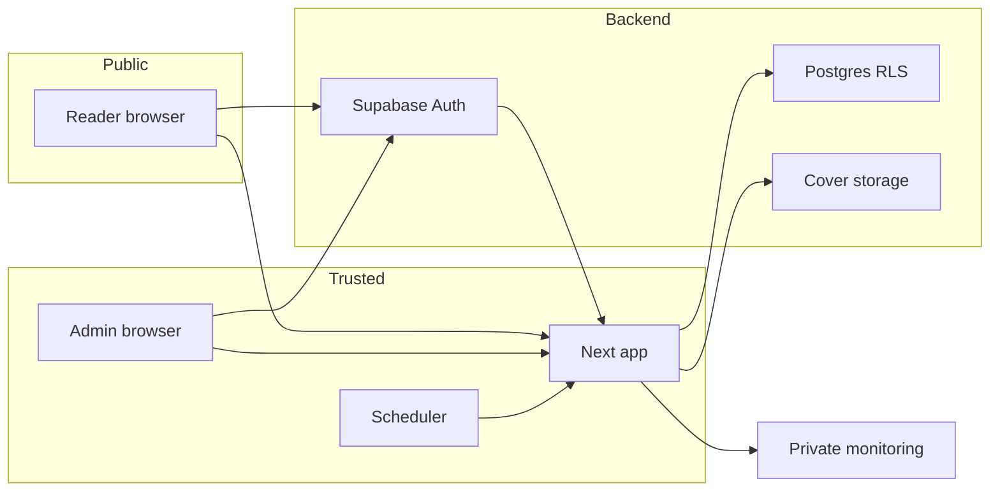

# Shelves of Mash threat model

Date: 2026-10-26. Evidence: local source and isolated checks, not a hosted penetration test.

## Executive summary

The principal risks are exposing private drafts or reader data, bypassing administrator authorization, and compromising server credentials. Supabase policies and server guards provide complementary controls. Local SQL tests exercise those boundaries. The application also depends on correct hosted configuration, dependency patching, and provider-level abuse protection; those are not established by fixture tests.

## Scope and assumptions

The user confirmed on 2026-10-26 that this is a public personal archive with trusted administrators, private drafts, and reader-private bookmarks. Runtime scope includes `app/`, `components/`, `lib/`, `proxy.ts`, configuration, and migrations 0001–0009. The local fixture and CI are separate development surfaces. Supabase, Google, Vercel, email delivery, DNS, and account security are external dependencies whose live settings were not inspected here.

Open questions for rollout: whether the intended hosted application uses the matching Supabase endpoint and keys; which migrations are currently applied; actual SMTP, rate-limit/CAPTCHA, backup, and scheduler settings; any edge CSP. Historical memory reports migrations 0006/0007 applied, but that is not fresh verification.

## System model

### Primary components

- Next.js renders public writing and discovery pages and executes authenticated server actions.
- Supabase Auth supplies identities; profiles supply administrator/reader roles.
- Supabase Postgres stores archive content, private reader records, and operational events. RLS and RPC grants enforce access.
- Supabase Storage holds public covers with administrator-only writes.
- The scheduler calls a bearer-protected publishing route. Server-only monitoring stores bounded application codes and optionally sends error events to a configured webhook.

### Data flows and trust boundaries

- Browser → Next.js over HTTP in local development and provider-managed HTTPS in production: URL inputs, forms, cookies, Markdown and uploads. Server actions authenticate and authorize; callback destinations are normalized by `localDestination`.
- Browser/Next.js → Supabase API: access tokens and queries. RLS enforces row ownership and published-content visibility. Privileged jobs use a service key confined to the server.
- Browser → Google/Supabase Auth → callback: external login and session exchange. Provider redirect allowlists, fresh links, and SMTP remain operational configuration.
- Scheduler → publishing route: bearer secret, no public UI authorization assumption.
- Next.js → monitoring store/webhook: static event names, bounded durations and application codes, without request URLs, tokens, or writing content.

#### Diagram

## Assets and security objectives

| Asset | Why it matters | Objective |
| --- | --- | --- |
| Draft and scheduled writing | Unpublished personal content | Confidentiality, integrity |
| Bookmarks and reader records | Private reading activity | Confidentiality, integrity |
| Published archive and covers | Author's work and identity | Integrity, availability |
| Sessions and service credentials | Account and database authority | Confidentiality |
| Publishing and monitoring | Reliable release and diagnosis | Integrity, availability |

## Attacker model

### Capabilities

An anonymous visitor can request public routes and API endpoints, supply URLs and view identifiers, and attempt authentication. A signed-in reader can call Supabase directly and submit forged requests rather than relying on visible UI. Both can attempt repeated requests and malicious input.

### Non-capabilities

An ordinary visitor does not possess the service key, cron secret, administrator session, SQL-editor access, or deployment credentials. Administrators are trusted content authors. Compromise of those credentials changes the model and requires incident response, not another client-side guard.

## Entry points and attack surfaces

| Surface | Reachability and boundary | Existing control and evidence |
| --- | --- | --- |
| Public reads and cache | Anonymous request to application/database | Published-only anonymous client; `lib/data/public-cache.ts`, `lib/data/writings.ts` |
| Login/callback | External identity to local session | Auth code exchange and local destinations; `app/auth/callback/route.ts`, `lib/auth/local-destination.ts` |
| Admin actions/previews | Authenticated user to privileged mutation | `requireAdmin`; `lib/actions/writings.ts`, `app/admin/layout.tsx` |
| Direct database requests | Reader token to rows/RPCs | RLS, column grants, guarded functions; migrations 0001, 0004, 0006, 0007 |
| Markdown and search excerpts | Stored text to browser | `react-markdown`, sanitization, React text rendering; `lib/markdown.tsx`, `components/writing/writing-card.tsx` |
| Cover upload | Admin file to public Storage | Type/size validation and Storage policies; `lib/storage/covers.ts`, migration 0004 |
| Cron publishing | External request to service authority | Bearer comparison and server-only client; `app/api/cron/publish-scheduled/route.ts` |
| Monitoring | Failures to private records/webhook | Redacted names/codes, timeouts, admin-only reads; `lib/monitoring.ts`, migration 0009 |
| Fixture/CI | Local development processes | Loopback synthetic backend and explicit environment overrides; `tests/run-fixtures.mjs`, `playwright.config.ts` |

## Top abuse paths

1. A reader forges a profile role change, then requests admin content. Migration 0004 restricts updates to `display_name`; isolated SQL rejects the role change.
2. A reader queries another reader's bookmarks or private writing directly. Owner/publication policies deny those rows; application guards do not replace these policies.
3. A private response enters shared cache or remains after unpublishing. Public reads use an anonymous client; mutations immediately expire the public cache tag. Private reads stay request-specific.
4. Malicious Markdown or search text becomes executable browser content. Sanitized Markdown and React text interpolation prevent raw search HTML insertion; browser checks include script/link payloads.
5. A visitor manufactures browser identifiers or floods public reads. Browser deduplication is not person verification; provider rate limits and operational monitoring remain necessary operational controls.
6. A stolen cron or service credential bypasses normal reader permissions. Server-only imports and secret separation reduce accidental exposure, while provider/account security and rotation remain essential.

## Threat model table

| ID | Source and prerequisite | Action and impact | Assets | Existing controls | Gaps and mitigations | Detection | Likelihood | Impact | Priority |
| --- | --- | --- | --- | --- | --- | --- | --- | --- | --- |
| TM-001 | Reader with account | Escalate role or bypass RLS to read/edit private content | Drafts, archive | Column grants, RLS, `requireAdmin` | Verify hosted migrations and grants before rollout | SQL authorization regressions and provider logs | Low with verified controls | High | high |
| TM-002 | Visitor during publication changes | Read private content through shared cache | Drafts, reader data | Anonymous public client; private reads uncached; mutation invalidation | Preserve invalidation in future actions; test hosted cache behavior | Cache isolation and unpublish tests | Low | High | medium |
| TM-003 | Attacker-supplied content or compromised author | Execute script or unsafe link in reader browser | Sessions, reading integrity | Sanitized Markdown and text excerpts | Evaluate compatible CSP with actual nonce/font/theme behavior; do not loosen sanitization | Browser payload regressions | Low under trusted-author model | High | medium |
| TM-004 | Anonymous repeated caller | Inflate synthetic views or consume compute/storage | Metrics, availability | Published-only RPC, UUID validation, per-identity registry, bounded lists | Anonymous identifiers remain forgeable; review provider abuse limits at deployment | Private error/slow-query events and provider metrics | Medium | Medium | medium |
| TM-005 | Stolen server/job secret | Perform privileged writes or unauthorized publication | Entire database, publishing | Server-only client; bearer gate; secrets excluded from client configuration | Verify secret access/rotation and backups externally | Unauthorized cron tests, publishing event history | Low absent credential exposure | High | high |
| TM-006 | Malicious dependency input or compromised tooling | Exhaust build/runtime resources | Availability, build chain | Lockfile, patched Next.js, CI audit | Four moderate Tailwind/PostCSS advisories remain; do not accept untrusted CSS. A Tailwind major migration needs separate compatibility work | npm audit and CI checks | Low for author-controlled CSS | Medium | low |

Priorities describe control areas, not confirmed exploitable findings. No unresolved high-impact exploit was established by the completed local checks. That does not certify hosted security.

## Criticality calibration

- Critical: unauthenticated server execution or exposed service credentials that permit broad database compromise.
- High: unauthorized draft access, role escalation, cross-reader private data access, or unauthorized publication.
- Medium: repeatable resource exhaustion, exploitable stale-cache exposure under restrictive prerequisites, or material view-statistic abuse.
- Low: development-only failures requiring trusted source changes, non-sensitive diagnostics, or cosmetic interaction defects.

## Focus paths for security review

| Paths | Reason | Threats |
| --- | --- | --- |
| `supabase/migrations/`, `lib/auth/require-admin.ts` | Role, row and function boundaries | TM-001, TM-005 |
| `lib/data/`, `lib/actions/`, cron route | Public/private cache and mutation lifecycle | TM-002, TM-004 |
| `lib/markdown.tsx`, writing cards, auth destinations | Browser rendering and navigation | TM-003 |
| `lib/supabase/admin.ts`, monitoring, CI | Privilege isolation and dependencies | TM-005, TM-006 |

## Verification and limits

`tests/security-db.mjs` checks reader/admin permissions, private records, Storage policy predicates, operational-event privacy, and an archive-data round trip into a separate isolated database. Existing view/scalability/publication SQL tests cover RPC grants, ranking, counts, timestamps and larger datasets. Browser workflow tests exercise real application actions against synthetic HTTP responses; they do not prove Supabase's hosted Auth, MIME enforcement, SMTP delivery, deployment TLS, or RLS implementation. The archive restore proof excludes Auth users, Storage objects, and full provider disaster recovery.

The review covers identified runtime entry points and distinguishes local test tooling. The scope was confirmed by the user; hosting details remain explicit open questions. Security ownership analysis was omitted because the trusted personal-project model did not establish a useful multi-maintainer ownership question.
